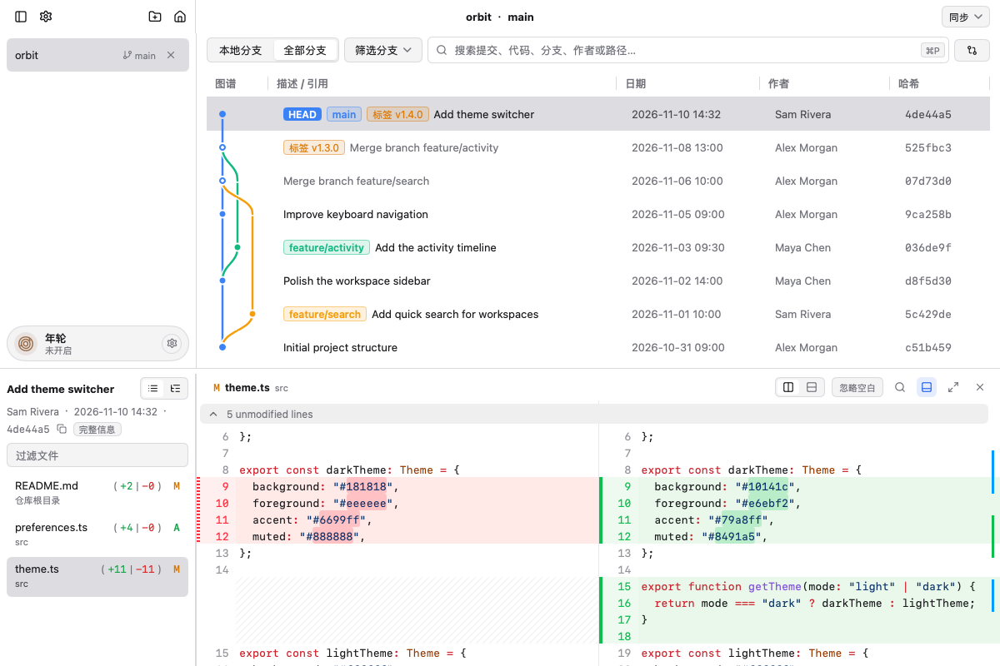

<p align="center">
  
</p>
<h1 align="center">Xylring</h1>
<h3 align="center">A native Git progress cockpit for AI-driven development.</h3>
<p align="center">
  Track commit volume, AI &amp; agent provenance, and lingering worktrees across parallel projects—without opening a heavy editor.
</p>
<p align="center">
  <a href="#-why-xylring">Why Xylring</a> •
  <a href="#-key-features">Features</a> •
  <a href="#-installation">Installation</a> •
  <a href="#-cli-usage">CLI Usage</a> •
  <a href="#-roadmap">Roadmap</a> •
  <a href="./README_zh.md">简体中文</a>
</p>
<p align="center">
  
  
  
  <a href="https://github.com/2fa0/xylring/actions/workflows/test.yml"></a>
  
</p>
<p align="center">
  
</p>

---

## 🔍 Why Xylring?

Xylring started from a very specific workflow: building Snapover without writing a single line of code by hand.

When AI models and coding agents are writing the code across multiple parallel projects, you don't always want to open an IDE just to answer basic questions:

- How much progress has actually been made?
- How many files did that last commit touch?
- Which AI model and agent authored each commit?
- Which branch am I on across my parallel repos, and how many `git worktree`s did I forget to delete?

The visual inspiration came from VS Code's Git Graph—great for reading history, but VS Code's memory footprint is far too heavy just to check Git state. Zed keeps memory well under control, but its built-in Git Graph felt rough and hard to use.

So Xylring was stitched together as a lightweight, Go-native desktop companion—named after the growth rings of a tree, recording every code change and AI collaboration step at a glance.

---

## ✨ Key Features

- 📊 **Commit Nodes Scaled by Change Volume**: The more files and lines a commit touches, the larger its node appears on the graph. One glance at the tree tells big refactors apart from small fixes.
- 🤖 **AI & Agent Provenance Right Next to the Graph**: See which AI model and agent produced each commit directly to the right of the commit graph (`Co-authored-by`, `AI-Generated-By`, `Prompt-SHA`)—no need to click into individual commits.
- 🌿 **Lingering Worktree Awareness**: Keep track of active and undeleted `git worktree`s when running parallel agent tasks, so temporary workspaces never pile up unnoticed.
- 🧭 **Multi-Project Orientation Without an IDE**: Stay oriented across parallel repositories and branches with direct Go-native repository access and smooth custom Bezier commit graph rendering.
- ✂️ **Hunk & Line Staging**: Review diffs and stage or discard specific lines and hunks directly from the diff view when you want fine-grained control.
- ⚡ **Omni-Search & CLI Helper**: Filter history by commit message, author, changed files, ref names, or commit hash (including `code:`, `author:`, and `path:` prefixes), and jump straight into any repo from the terminal with `xylring .`.
- 🖼️ **Full-File Source View & Image Diff**: Read full-file snapshots with syntax highlighting and compare images side by side.
- ⚖️ **Arbitrary Snapshots & Merge-Base Comparison**: Compare any two commits, branches, or tags—two-dot snapshot diffing or three-dot (`...`) fork-point diffing.
- 🛡️ **Local Repository Workflows**: Local operations use the system Git installation. Fetch, pull, and push communicate with the configured Git remote.
- 🎨 **Native Cross-Platform UI**: Runs natively on macOS and Windows with dark, light, and high-contrast themes.

---

## 🚀 Installation

### macOS

Download the `.dmg` matching your architecture from [Release v0.8.4](https://github.com/2fa0/xylring/releases):

- **Apple Silicon (M1/M2/M3/M4)**: `xylring-0.8.4-arm64.dmg`
- **Intel x86_64**: `xylring-0.8.4-amd64.dmg`

Or grab the `.app.tar.gz` archive if you prefer to place the app yourself. Open the disk image and drag **Xylring** into your `Applications` folder.

> [!NOTE]
> **First launch on macOS**: if a build is distributed without Apple notarization, right-click (or Control-click) `Xylring.app` in Finder and choose **Open** the first time. Or run:
> ```sh
> xattr -cr /Applications/Xylring.app
> ```

Once installed, Xylring checks for new versions itself and offers to update in its own window. Versions up to 0.8.2 have no updater yet, so install a build with it once by hand.

### Windows

Download the `.exe` installer or the standalone `.zip` archive from [Releases](https://github.com/2fa0/xylring/releases):

- **Installer**: run `xylring-setup-0.8.4-amd64.exe` (installs to your user directory, no admin rights required).
- **Portable**: extract `xylring-0.8.4-windows-x64.zip` and run `Xylring.exe`.

### Build from Source

Requirements: **Go 1.27+**, system **Git**, and the Cgo dependencies needed by the Fyne/GLFW GUI bindings.

```sh
# Clone the repository, then run from its root
# Run directly
go run ./cmd/gitclient /path/to/your/repo

# Or build a native macOS .app
cd cmd/gitclient
go tool mygo build -skip-dmg -skip-notarize
```

---

## 💻 CLI Usage

Open the current directory in Xylring, just like `code .`:

```sh
xylring .
```

Open a specific repository path, or several at once:

```sh
xylring /path/to/repository
xylring repoA repoB

# Just focus the running Xylring window
xylring
```

### Install CLI Helper in PATH

- **From the GUI menu**: `File` → `Install 'xylring' Command Line Tool in PATH...`
- **From the terminal**:
  ```sh
  xylring install-cli
  ```

---

## 🗺️ Roadmap

- [x] High-performance commit graph with cubic Bezier lanes
- [x] Commit node sizing by change volume & inline AI provenance display
- [x] Omni-search across messages, authors, files, refs, and SHAs
- [x] Hunk-level staging and interactive patch discard
- [x] Dual-point and triple-point (`...`) commit comparisons
- [x] Syntax-highlighted full-file viewer and image diffing
- [x] CLI `xylring .` terminal integration & macOS/Windows support
- [ ] Interactive Rebase UI (Squash, Reorder, Drop)
- [ ] Linux desktop support (X11 / Wayland)
- [ ] Custom themes (Solarized, Nord, Catppuccin)
- [ ] Vim-style keyboard navigation

---

## 🔒 Privacy and local data

Xylring stores diagnostic logs under `~/Library/Application Support/Xylring/logs/`
on macOS and `%AppData%\Xylring\logs\` on Windows. The normal log
(`xylring.log`) and crash log (`crash.log`) can contain local repository paths,
operation errors, and crash details. They rotate at approximately 1 MiB and are
cleaned under a seven-day retention policy; active files or cleanup failures may
remain longer. macOS may also create its own diagnostic reports.

The application stores recent repository paths and session state locally,
including unsent commit-message drafts, in `recent.json` and `session.json`
under the same `Xylring` configuration directory. Xylring does not implement
automatic telemetry or log uploads. Explicit remote Git operations use the
system Git configuration and communicate with the configured remote. Review
logs and session files before sharing them.

---

## 🛡️ Reporting security vulnerabilities

Please report potential vulnerabilities privately, following the
[security policy](SECURITY.md), rather than opening a public issue.

---

## 🤝 Feedback

Bugs, feature ideas and pull requests are welcome in the
[issue tracker](https://github.com/2fa0/xylring/issues). See
[CONTRIBUTING.md](CONTRIBUTING.md) for how to build and test a change.

---

## 🙏 Thanks

Xylring's interface is built with [MyGo](https://github.com/egoist/mygo), a
native Go desktop UI toolkit that keeps the app small and fast without shipping
a browser engine. Thanks to [@egoist](https://github.com/egoist) and every MyGo
contributor—the commit graph, diff viewer, and menus all sit on top of it.

---

## 📄 License

Xylring is released under the [Apache License 2.0](LICENSE).

In short: you may use, copy, modify and distribute this software, for commercial
or non-commercial purposes, and you may distribute modified versions, as long as
you keep the copyright and license notices, state which files you changed, and
include a copy of the [LICENSE](LICENSE) and the [NOTICE](NOTICE) file. The
license also grants an express patent license from contributors. The software is
provided "as is", without warranty of any kind.

Third-party components retain their own licenses; see the
[third-party notices](cmd/gitclient/resources/THIRD_PARTY_NOTICES.txt).
