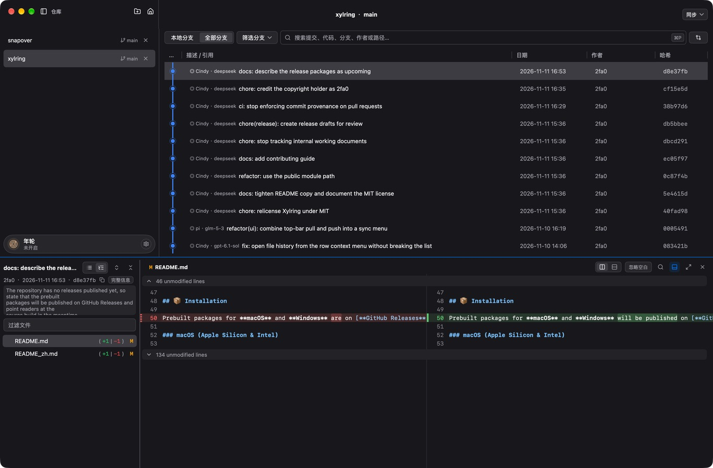

<p align="center">
  
</p>

<h1 align="center">Xylring</h1>

<p align="center">
  <strong>A native Git client built with Go.</strong><br>
  Browse repository history, review changes, and work with Git from a desktop interface.
</p>

<p align="center">
  <a href="#why-xylring">Features</a> •
  <a href="#installation">Installation</a> •
  <a href="#cli-usage">CLI Usage</a> •
  <a href="#roadmap">Roadmap</a> •
  <a href="./README_zh.md">简体中文</a>
</p>

<p align="center">
  
  
  
</p>

<p align="center">
  
</p>

---

## 💡 Why Xylring?

Xylring is a desktop Git client built with Go and MyGo. It uses the system Git
installation to browse and change local repositories.

---

## ⚡ Highlights

- 🚀 **Native Desktop App**: Built with Go and MyGo, without an Electron-based interface.
- 🎨 **Cubic Bezier Graph**: Smooth branch curves tracking the first-parent lane. View the whole repository history without jitter or stutter across pagination.
- 🔍 **Omni Search with Autocomplete**: A single search box covering commit messages, code changes (Pickaxe `-S`), author names, file paths, branches, tags, and commit hashes. Supports prefixes like `code:`, `author:`, and `path:`. Built-in in-diff find (⌘F / Ctrl+F) with match highlights.
- ⚖️ **Arbitrary Snapshots & Merge-Base Comparison**: Compare any two commits, branches, or tags. Supports two-dot snapshot diffing or three-dot (`...`) branch fork diffing.
- 🧩 **Hunk-Level Interactive Staging**: Review and stage individual patch hunks, discard changes, or amend previous commits with a single click.
- 💻 **Terminal-First Workflow**: Launch any repository right from your terminal with `xylring .`, `xylring /path/to/repo`, or switch between multiple repositories effortlessly.
- 🖼️ **Full-File Source View & Image Diff**: Read full-file snapshots with syntax highlighting and inspect visual image diffs side-by-side.
- 🛡️ **Local Repository Workflows**: Local operations use the system Git installation. Fetching, pulling, and pushing communicate with the configured Git remote.
- 🧭 **Finds Your Git**: Uses the Git on `PATH` or a common install location such as Homebrew. When Git is missing or cannot run, the app says why, retries on demand, and accepts a custom Git executable path.

---

## 📦 Installation

Download prebuilt packages for **macOS** and **Windows** from [**GitHub Releases**](https://github.com/2fa0/xylring/releases).

### macOS (Apple Silicon & Intel)

1. Download the `.dmg` matching your architecture:
   - **Apple Silicon (M1/M2/M3/M4)**: `xylring-0.8.2-arm64.dmg`
   - **Intel x86_64**: `xylring-0.8.2-amd64.dmg`
2. Open the disk image and drag **Xylring** into your `Applications` folder.

> [!NOTE]
> **First-time launch on macOS**:  
> If a release is distributed without Apple notarization, right-click (or Control-click) `Xylring.app` in Finder and select **Open** on the first launch. Or run:
> ```sh
> xattr -cr /Applications/Xylring.app
> ```

### Windows (10 & 11 x64)

- **Installer**: Download and run `xylring-setup-0.8.2-amd64.exe` (installs to user directory, no admin rights required).
- **Portable**: Download and extract `xylring-0.8.2-windows-x64.zip`, then run `Xylring.exe`.

### Build from Source

Requirements: **Go 1.27+** and system **Git**.

```sh
# Clone the repository
git clone https://github.com/2fa0/xylring.git
cd xylring

# Run directly
go run ./cmd/gitclient /path/to/your/repo

# Or build native macOS .app
cd cmd/gitclient
go tool mygo build -skip-dmg -skip-notarize
```

---

## 🚀 CLI Usage

Seamlessly inspect any Git repository directly from your terminal, just like `code .`:

```sh
# Open repository in current directory
xylring .

# Open specific repository
xylring /path/to/project

# Open multiple repositories side-by-side
xylring repoA repoB

# Just focus/activate the running Xylring window
xylring
```

### Install CLI Helper in PATH
- **From GUI Menu**: Select `File` → `Install 'xylring' Command Line Tool in PATH...`
- **From Terminal**:
  ```sh
  xylring install-cli
  ```

---

## 🗺️ Roadmap

- [x] High-performance commit graph with cubic Bezier lanes
- [x] Omni-search across messages, authors, files, refs, and SHAs
- [x] Hunk-level staging and interactive patch discard
- [x] Dual-point and triple-point (`...`) commit comparisons
- [x] Syntax-highlighted full-file viewer and image diffing
- [x] CLI `xylring .` terminal integration
- [x] Cross-platform support for macOS (ARM64/x64) and Windows (x64)
- [ ] Interactive Rebase UI (Squash, Reorder, Drop)
- [ ] Linux desktop support (X11 / Wayland)
- [ ] Custom themes (Solarized, Nord, Catppuccin)
- [ ] Vim-style keyboard navigation

---

## 🔒 Privacy and local data

Xylring stores diagnostic logs under `~/Library/Application Support/Xylring/logs/`
on macOS and `%AppData%\Xylring\logs\` on Windows. The normal log
(`xylring.log`) and crash log (`crash.log`) can contain local repository paths,
operation errors, and crash details. They rotate at approximately 1 MiB and are
cleaned under a seven-day retention policy; active files or cleanup failures may
remain longer. macOS may also create its own diagnostic reports.

The application stores recent repository paths and session state locally,
including unsent commit-message drafts, in `recent.json` and `session.json`
under the same `Xylring` configuration directory. Xylring does not implement
automatic telemetry or log uploads. Explicit remote Git operations use the
system Git configuration and communicate with the configured remote. Review
logs and session files before sharing them.

---

## 🛡️ Reporting security vulnerabilities

Please report potential vulnerabilities privately to
[11802492+2fa0@users.noreply.github.com](mailto:11802492+2fa0@users.noreply.github.com), rather than opening a public
issue. Include the affected version, reproduction steps, and impact; remove
credentials and other sensitive information from any logs or sample repositories.
Reports will be reviewed on a best-effort basis. Please reproduce against the
latest default branch or latest available release when practical.

---

## 🤝 Contributing

Contributions, issues, and feature requests are welcome!  
Use the [issues page](https://github.com/2fa0/xylring/issues) for public issues; report security vulnerabilities privately as described below.

1. Fork the Project
2. Create your Feature Branch (`git checkout -b feat/AmazingFeature`)
3. Commit your Changes (`git commit -m 'feat: add some amazing feature'`)
4. Push to the Branch (`git push origin feat/AmazingFeature`)
5. Open a Pull Request

---

## 📄 License

Xylring is released under the [MIT License](LICENSE).

In short: you may use, copy, modify, merge, publish, distribute, sublicense,
and/or sell copies of this software, for commercial or non-commercial purposes,
as long as the copyright notice and permission notice are included in all copies
or substantial portions of the Software. The software is provided "as is",
without warranty of any kind.

Third-party components retain their own licenses; see the
[third-party notices](cmd/gitclient/resources/THIRD_PARTY_NOTICES.txt).
