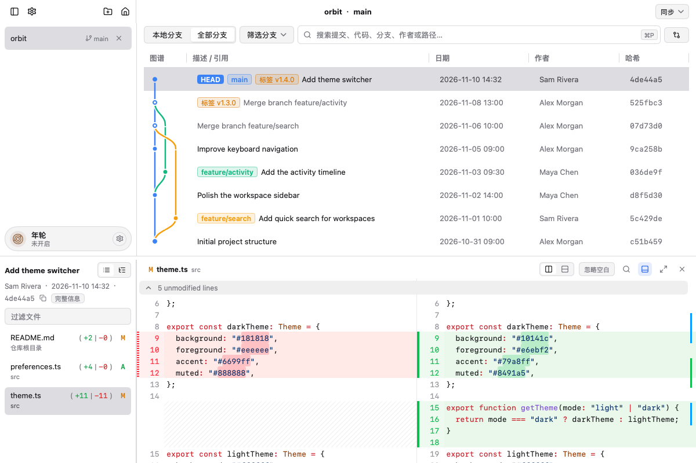

<p align="center">
  
</p>
<h1 align="center">Xylring</h1>
<h3 align="center">面向 AI 编程工作流的原生 Git 进度看板。</h3>
<p align="center">
  不用打开重型编辑器，一眼看清多项目进度、每次改动量、AI 与 Agent 归属，以及尚未清理的 Worktree。
</p>
<p align="center">
  <a href="#-为什么做-xylring">设计初衷</a> •
  <a href="#-核心特性">核心特性</a> •
  <a href="#-安装方式">安装方式</a> •
  <a href="#-命令行用法">命令行用法</a> •
  <a href="#-路线图">路线图</a> •
  <a href="./README.md">English</a>
</p>
<p align="center">
  
  
  
  <a href="https://github.com/2fa0/xylring/actions/workflows/test.yml"></a>
  
</p>
<p align="center">
  
</p>

---

## 🔍 为什么做 Xylring？

Xylring 诞生于一个很具体的真实需求：我想在不手写一行代码的前提下，靠 AI 完整做出 Snapover。

当 AI 和多个 Agent 在后台并行推进不同项目时，你往往不想为了看一眼状态而专门打开编辑器，但又迫切需要知道几件事：

- 现在整体进度推进到哪了？
- 刚才那次提交到底改了多少个文件？
- 每次提交分别是哪个 AI 模型和 Agent 帮我干的活？
- 同时并行好几个项目时，我现在切在哪个仓库、哪个分支？还有多少个 `git worktree` 忘了删？

界面交互的灵感最初来自 VS Code 的 Git Graph——图很直观，但只为了看 Git 状态就常驻一个 VS Code，内存开销实在太大；我也试过 Zed，Zed 的内存控制非常优秀，可惜自带的 Git Graph 既不好看也不顺手。

于是我干脆自己动手，用 Go 缝了一个原生轻量的桌面工具出来。Xylring 意为树木的年轮——像年轮一样，把每一次代码演进和 AI 协作的印记清晰地刻在时间线上。

---

## ✨ 核心特性

- 📊 **提交节点大小映射改动量**：单次提交改动的文件和代码越多，图上的提交点就越大。扫一眼提交树，就能立刻分辨哪些是大重构、哪些是小修补。
- 🤖 **图右侧直出 AI 与 Agent 归属**：在提交树的右侧直接展示每次提交对应的 AI 与 Agent 信息（解析 `Co-authored-by`、`AI-Generated-By`、`Prompt-SHA` 等 Trailer），不用点进详情就能看清是谁干的活。
- 🌿 **未删除 Worktree 实时提醒**：多 Agent 并行开发时最容易遗忘清理临时工作区，Xylring 把当前残留的 `git worktree` 数量直接摆在明面上。
- 🧭 **脱离编辑器的多项目防迷路**：通过 Go 原生接口直接读取仓库状态，配合平滑的贝塞尔曲线提交树，不开 IDE 也能快速切换和定位当前工作进度。
- ✂️ **行级与 Hunk 级 Diff 审查**：需要人工介入微调时，支持在 Diff 视图中直接暂存或丢弃指定的代码行与代码块（Hunk）。
- ⚡ **全局快搜与终端联动**：支持按提交信息、作者、改动文件、分支引用或 Commit Hash 秒搜历史（支持 `code:`、`author:`、`path:` 等前缀）；在终端输入 `xylring .` 即可直接打开当前仓库。
- 🖼️ **全量文件语法高亮与图片 Diff**：支持查看任意历史快照的完整只读文件，支持多格式图片并排对比。
- ⚖️ **快照与分叉点任意比对**：任意选择两个提交或分支比对，支持两点快照比较或三点（`...` 分叉点起）改动审查。
- 🛡️ **本地仓库操作**：本地操作调用系统 Git；获取、拉取和推送会连接配置的 Git 远程仓库。
- 🎨 **原生跨平台界面**：原生运行于 macOS 与 Windows，内置深色、浅色与高对比度主题。

---

## 🚀 安装方式

### macOS

根据芯片架构从 [Release v0.8.4](https://github.com/2fa0/xylring/releases) 下载对应的 `.dmg`：

- **Apple 芯片 (M1/M2/M3/M4 系列)**：`xylring-0.8.4-arm64.dmg`
- **Intel 芯片 (x86_64)**：`xylring-0.8.4-amd64.dmg`

也可以下载 `.app.tar.gz` 自行放置应用。双击打开 `.dmg`，把 **Xylring** 拖入「应用程序（Applications）」文件夹。

> [!NOTE]
> **macOS 首次打开安全提示**：如果发行版本未经过 Apple 开发者证书公证，初次打开提示“无法验证开发者”时，请在访达（Finder）里按住 **Control** 点按 `Xylring.app` 并选择「打开」，或在终端执行：
> ```sh
> xattr -cr /Applications/Xylring.app
> ```

装好之后，Xylring 会自己检查新版本：有新版本时弹出更新窗口，装完重启即可。0.8.2 及更早的版本还没有这项能力，需要手动装一次带自动更新的版本。

### Windows

从 [Releases](https://github.com/2fa0/xylring/releases) 下载 `.exe` 安装程序或免安装 `.zip` 压缩包：

- **安装版**：运行 `xylring-setup-0.8.4-amd64.exe`（安装到当前用户目录，无需管理员权限）。
- **便携版**：解压 `xylring-0.8.4-windows-x64.zip`，直接双击 `Xylring.exe` 即可运行。

### 从源码构建

环境要求：**Go 1.27+**、系统 **Git**，以及 Fyne/GLFW 图形绑定所需的 Cgo 依赖。

```sh
# 先克隆仓库，再在仓库根目录运行
# 直接运行
go run ./cmd/gitclient /path/to/your/repo

# 或编译 macOS 原生 .app
cd cmd/gitclient
go tool mygo build -skip-dmg -skip-notarize
```

---

## 💻 命令行用法

像 VS Code 的 `code .` 一样，在终端随时打开当前目录的仓库：

```sh
xylring .
```

也可以打开指定路径的仓库，或一次打开多个：

```sh
xylring /path/to/repository
xylring repoA repoB

# 仅激活并聚焦当前运行的 Xylring 窗口
xylring
```

### 将命令行工具添加到 PATH

- **通过界面菜单**：`File` → `Install 'xylring' Command Line Tool in PATH...`
- **通过终端命令**：
  ```sh
  xylring install-cli
  ```

---

## 🗺️ 路线图

- [x] 基于三次贝塞尔曲线的高性能提交树渲染
- [x] 提交节点按改动量缩放与图右侧 AI 来源展示
- [x] 覆盖提交信息、作者、文件、分支与 SHA 的全局快搜
- [x] Hunk 级暂存与交互式补丁丢弃
- [x] 双点与三点（`...`）提交对比
- [x] 语法高亮全文件预览与图片 Diff 对比
- [x] 终端 `xylring .` 联动及 macOS / Windows 双端支持
- [ ] 交互式 Rebase 界面（Squash、Reorder、Drop）
- [ ] Linux 桌面端支持（X11 / Wayland）
- [ ] 更多内置配色主题（Solarized、Nord、Catppuccin）
- [ ] Vim 风格键盘导航

---

## 🔒 隐私与本地数据

Xylring 会在本地保存诊断日志，macOS 位于 `~/Library/Application Support/Xylring/logs/`，Windows 位于 `%AppData%\Xylring\logs\`。常规日志（`xylring.log`）与崩溃日志（`crash.log`）可能包含本地仓库路径、操作报错及崩溃堆栈信息；单个日志文件约在 1 MiB 时轮转，并按 7 天保留策略自动清理（正在写入或清理失败的文件可能会保留更久）。macOS 系统本身也可能会生成系统级诊断报告。

应用还会在同一配置目录下的 `recent.json` 和 `session.json` 中保存最近打开的仓库路径与会话状态（包括尚未提交的 Commit 草稿）。Xylring 不包含任何自动遥测或日志上传逻辑；主动触发的远程 Git 操作会直接调用系统 Git 配置并与对应远程仓库通信。分享日志或配置文件前请先自行检查内容。

---

## 🛡️ 报告安全漏洞

如发现潜在安全漏洞，请遵循[安全策略](SECURITY.md)私下联系报告，不要直接在公开 Issue 中披露。

---

## 🤝 反馈与贡献

欢迎在 [Issue 列表](https://github.com/2fa0/xylring/issues) 反馈 Bug、提出建议或提交 Pull Request。构建与测试方式请参阅 [CONTRIBUTING.md](CONTRIBUTING.md)。

---

## 🙏 致谢

Xylring 的界面基于 [MyGo](https://github.com/egoist/mygo) 构建——它让这个应用不必内置浏览器内核，就能保持原生、轻量、启动即用。感谢 [@egoist](https://github.com/egoist) 与所有 MyGo 贡献者，提交图谱、Diff 视图和菜单都跑在它上面。

---

## 📄 开源协议

Xylring 基于 [Apache License 2.0](LICENSE) 协议开源。

简而言之，你可以自由地将本软件用于商业或非商业用途，也可以修改并分发修改后的版本，但需保留原有的版权与协议声明、注明所修改的文件，并随分发附上 [LICENSE](LICENSE) 与 [NOTICE](NOTICE) 文件。协议同时包含贡献者的明确专利授权；软件按“现状”提供，不附带任何形式的担保。

内置第三方组件各自保留其原有协议，详见[第三方声明文件](cmd/gitclient/resources/THIRD_PARTY_NOTICES.txt)。
